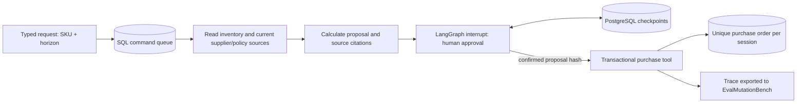

# Retail replenishment reference application

This is a real database-backed reference workflow on synthetic business inputs.
It proposes a purchase, pauses for human approval, resumes from PostgreSQL
checkpoints after worker restart, and creates one database purchase order per
session. It does not contact a supplier, spend money, or claim business uplift.

The first milestone deliberately uses a deterministic planner and no paid LLM
calls. It establishes the tool, approval, persistence, and trace contracts before
adding a model planner. Generated oracle labels remain distinct from human labels.

## Workflow



The initial corpus contains three SKUs, with two current source chunks per SKU:
supplier terms and purchasing policy. Source metadata includes SKU, current
version, source URI, and structured rules. Sources are filtered by SKU and current
version before ranking. Missing or ambiguous required rules block execution.

For `COFFEE-001`, seven-day sales are 70 units, stock is 20, cost is 500 cents per
unit, supplier packs contain 10 units, and the policy caps purchases at 500 units.
For a 14-day horizon: target stock = ceil(70 × 14 / 7) = 140; deficit = 120;
rounded order = 120; cost = 60,000 cents. The proposal includes two citations.
Purchase orders do not increment on-hand stock: ordered stock has not been received.

## One-command acceptance after startup

Use the environment and Compose startup in [service.md](service.md), then:

```bash
python3 scripts/retail_smoke.py --restart-worker
```

This script creates a session, asserts that no order exists before approval,
restarts only the Compose `worker` service, confirms the saved proposal, and checks
the resulting order. It checks both repeated idempotent confirmation and rejection
of a second confirmation under another key. Run it against your own isolated
local stack: `--restart-worker` operates on the Compose project in the current
directory. The script writes `artifacts/retail-session.json`, ignored by Git.

A captured result from the verified worker-restart run is included as
[examples/retail/session.json](../examples/retail/session.json). It uses synthetic
fixtures and can be exported into mutation pairs without starting Docker.

For a different local port set `EVALMUT_API_PORT` before Compose startup and pass
`--url http://127.0.0.1:PORT` to both smoke scripts.

## HTTP API

All retail endpoints require the same operator bearer token as evaluation runs.
Retail execution is enabled by `EVALMUT_RETAIL_ENABLED=1` (enabled in Compose).

```bash
curl -X POST http://127.0.0.1:8000/v1/retail/sessions \
  -H "Authorization: Bearer $EVALMUT_SERVICE_TOKEN" \
  -H 'Idempotency-Key: coffee-14-days-001' \
  -H 'Content-Type: application/json' \
  -d '{"sku":"COFFEE-001","target_days":14}'
```

The `202` response contains a command `run_id` and `request.session_id`. Poll
`GET /v1/runs/RUN_ID` for command completion, then read
`GET /v1/retail/sessions/SESSION_ID`. An initial command completes when the graph
has paused: the session phase is `awaiting_approval`, not `ordered`.

```bash
curl -X POST http://127.0.0.1:8000/v1/retail/sessions/SESSION_ID/approval \
  -H "Authorization: Bearer $EVALMUT_SERVICE_TOKEN" \
  -H 'Idempotency-Key: coffee-confirm-001' \
  -H 'Content-Type: application/json' \
  -d '{"approved":true,"proposal_sha256":"HASH_FROM_SESSION"}'
```

`approved:false` resumes the graph to `rejected`, without an order. An early,
conflicting, stale, or repeated decision under a different key returns `409`.
The same key and payload returns the original command even after completion.
Unexpected request fields and unsupported SKUs are rejected by Pydantic.

## Safety and recovery invariants

- The human decision and queued approval command commit in one SQL transaction.
- Confirmation is bound to the exact proposal SHA-256, including the source digest.
- A PostgreSQL advisory lock serializes one LangGraph thread across worker processes.
  Every session has a separate thread ID; checkpoints do not use a global session.
- The purchase transaction checks the stored positive human decision, proposal
  hash, SKU, inventory revision, current source digest, and active command lease.
- A unique session constraint and a replay check make the purchase tool idempotent.
  If the database write succeeds and graph checkpointing fails, a replay returns
  the existing order instead of inserting another one.
- Rejection never calls the purchase write tool. Document text cannot approve a
  purchase, change the graph route, execute SQL, or supply arbitrary tools.
- Inventory changes must increment the revision. Changed stock revisions or
  source content require a new recommendation and approval.
- Explicit initialization creates retail tables and runs checkpointer `setup()`;
  API/worker startup never creates tables.

The demonstrated restart occurs while awaiting human approval. Abrupt death during
an active command is handled by existing queue lease expiry; it does not silently
retry provider calls. A failed session requires a new request with a new key.
Automated recovery of active failed graph commands is a further acceptance gate.

This is a single-operator service. Session isolation is tested; multi-user RBAC,
tenant permissions, external procurement systems, migration tooling, and load
limits remain separate work. It provides a local reference order, not a guarantee
of exactly-once delivery to an external supplier.

## Retrieval modes

The runnable offline acceptance uses lexical retrieval. The optional hybrid path
uses BM25 and Sentence Transformers dense retrieval, reciprocal-rank fusion, then
CrossEncoder reranking. Install `uv sync --extra reference --extra retail --extra service`
and configure on both API and worker:

```bash
export EVALMUT_RETAIL_RETRIEVAL_MODE=hybrid
export EVALMUT_RETAIL_EMBEDDING_MODEL=/absolute/path/to/pinned/embedding/model
export EVALMUT_RETAIL_RERANKER_MODEL=/absolute/path/to/pinned/reranker/model
```

Select the model configuration before creating sessions. Configuration is saved
in the immutable start command and reused when the session resumes. The Compose
default image does not install heavyweight Sentence Transformers dependencies;
use a development environment or a derived image with `reference` installed for
this mode. Ranking logic is unit-tested with mocked model outputs; actual model
retrieval quality has not yet been measured on the three-SKU corpus.

## Benchmark bridge

```bash
uv run evalmut retail-export \
  --session artifacts/retail-session.json --output artifacts/retail-pairs.jsonl
uv run evalmut validate-dataset artifacts/retail-pairs.jsonl
uv run evalmut run --dataset artifacts/retail-pairs.jsonl \
  --adapter deterministic --output-dir artifacts/retail-eval
uv run evalmut score --dataset artifacts/retail-pairs.jsonl \
  --predictions artifacts/retail-eval/predictions.jsonl
```

One completed trace produces a valid evidence-reorder control and four mutations:
stale evidence, unsupported claim, wrong tool arguments, and missing approval.
These five pairs are a smoke test and stay in one development scenario group.
They are not added to the 300-pair release dataset or a human-validated leaderboard.

## Remaining milestones

- A provider-backed model planner with schemas, streaming, bounded retries and budgets.
- More documents, ingestion/chunking, and measured hybrid retrieval ablations.
- Human-grounded evaluator comparisons on application-generated traces.
- Alembic migrations, observability, load tests, and active-command crash recovery.

Persistence and interrupt behavior follow the official LangGraph guides:
[PostgreSQL checkpointers](https://docs.langchain.com/oss/python/langgraph/add-memory)
and [interrupt/resume semantics](https://docs.langchain.com/oss/python/langgraph/interrupts).
